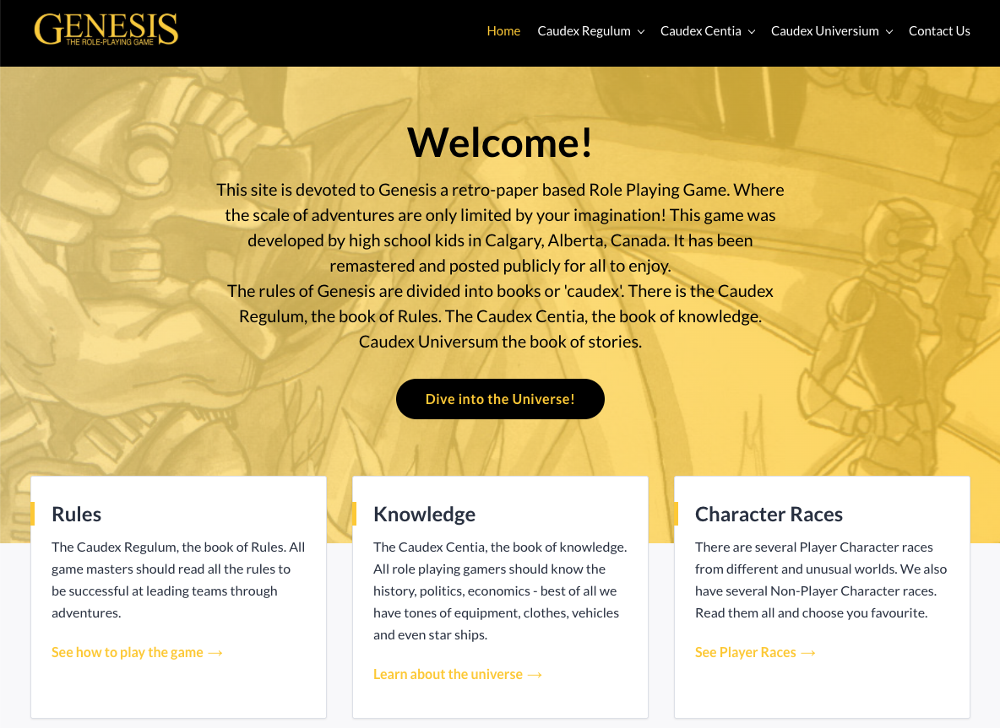

# ✨ Genesis RPG (genesisrpg.com) ✨

> A hard science fiction tabletop role-playing game where adventures are limited only by your imagination! Originally created by high school students in Calgary, Alberta, Canada, remastered into a modern, accessible Jamstack static site, and published for all to enjoy.

<p align="center">
  
</p>

The rules and universe of Genesis are organized into books or "caudex":
- **Caudex Regulum**: The Book of Rules (Mechanics, Character Creation, Combat, Star Travel).
- **Caudex Centia**: The Book of Knowledge (Species, Technology, Star Systems, History, Politics).
- **Caudex Universum**: The Book of Stories (Canonical short fiction and historical vignettes).

---

## 🚀 Recent Updates & Remaster Highlights

### Version 1.3.0 (2026-11-07) — Crawler & Generative AI Optimization
- **AI & LLM Machine-Readability**: Added [`/llms.txt`](file:///src/llms.txt) and [`/llms-full.txt`](file:///src/llms-full.txt) following open standards, providing structured universe, rule, and species summaries for AI research agents (ChatGPT, Claude, Perplexity, Gemini).
- **Automated XML Sitemap**: Eleventy template generating dynamic [`/sitemap.xml`](file:///src/sitemap.xml.njk) covering all 67+ canonical documentation chapters and story pages with priorities and change frequencies.
- **Search Engine Guidance**: Added [`/robots.txt`](file:///src/robots.txt) allowing crawler access and pointing to the sitemap.
- **Semantic JSON-LD Structured Data**: Embedded Schema.org entities across all layouts:
  - `WebSite` & `Game` entities on the home and layout level.
  - `TechArticle` and 3-tier `BreadcrumbList` across all rules and documentation chapters.
  - `BlogPosting` and `BreadcrumbList` across all fiction stories.
- **Story Asset Fixes**: Restored missing hero background image (`Full_JungleCamp.webp`) and thumbnails for "Welcome to Taleneed".

### Version 1.2.0 (2026-11-07) — CI/CD Pipeline & Mobile Performance
- **GitLab CI/CD Automated Deployment**: Configured `.gitlab-ci.yml` pipeline with automated test, build, and deploy stages using Google Cloud Service Account authentication (`FIREBASE_SERVICE_ACCOUNT`) to deploy directly to Firebase Hosting on commits to `master`.
- **Mobile PageSpeed Optimization (Boosted to 91+)**:
  - Hero image preload (`<link rel="preload" as="image" fetchpriority="high">`).
  - Non-render-blocking Google Fonts loading (`media="print" onload="this.media='all'"`).
  - Explicit image dimension attributes (`width` and `height`) to prevent Layout Shifts (CLS).
  - Below-the-fold image lazy loading (`loading="lazy"`).
  - 1-year immutable caching headers (`max-age=31536000, immutable`) for images in `firebase.json`.
  - Fixed syntax error in `site.webmanifest`.

### Version 1.1.0 (2026-11-07) — Eleventy SSG Architecture & Navigation
- **Eleventy Architecture**: Converted the static site into a DRY Eleventy setup using Nunjucks layouts (`base.njk`, `doc.njk`, `blog.njk`) and modular partials (`header.njk`, `docs-sidebar.njk`, `footer.njk`).
- **Sidebar Navigation State**: Added auto-expansion for active parent/sub-menus based on URL path and `sessionStorage` persistence so manually expanded accordions stay open during page navigation.
- **Automated Link Verification**: Added `scripts/verify-links.js` (`npm test`) auditing all internal links, anchors, and media assets.
- **Blog Feed Restoration**: Restored story grid on `/blog/` and canonical hero images across story pages.

### Version 1.0.0 (2026-11-07) — URL & Asset Resolution
- Converted all links, body references, and image maps to root-relative paths, eliminating 404s caused by Firebase `cleanUrls` trailing slash behavior.
- Purged dead Gatsby runtime bundles, unneeded preloads, and unused third-party CDNs.

---

## 🛠 Tech Stack & Tooling

- **Static Site Generator**: [Eleventy (11ty)](https://www.11ty.dev/) v3
- **Templating**: Nunjucks (`.njk`)
- **Hosting & CDN**: [Firebase Hosting](https://firebase.google.com/products/hosting) (`genesisrpg-site` / `genesisrpg.com`)
- **CI/CD**: GitLab CI (`.gitlab-ci.yml`)
- **Verification**: Node.js HTML and asset link auditor (`scripts/verify-links.js`)

---

## 💻 Development & Workflow

### 1. Install Dependencies
```bash
npm install
```

### 2. Local Preview
Start the local Eleventy development server with live reload:
```bash
npm run serve
```
Open `http://localhost:8080` in your browser.

### 3. Build & Test
Compile the static site to the `public/` directory and run internal link verification:
```bash
npm run build
npm test
```

### 4. Deployment
Commits pushed to the `master` branch automatically trigger the GitLab CI/CD pipeline, which tests, builds, and deploys the site to Firebase Hosting.

Manual deploy (with Firebase CLI):
```bash
firebase deploy --only hosting
```

---

## 📜 License & Attribution

<p xmlns:cc="http://creativecommons.org/ns#" xmlns:dct="http://purl.org/dc/terms/"><a property="dct:title" rel="cc:attributionURL" href="https://genesisrpg.com">Genesis - The Role Playing Game</a> by <a rel="cc:attributionURL dct:creator" property="cc:attributionName" href="https://twitter.com/kevindclarke">IUV</a> is licensed under <a href="http://creativecommons.org/licenses/by-nc-nd/4.0/?ref=chooser-v1" target="_blank" rel="license noopener noreferrer" style="display:inline-block;">CC BY-NC-ND 4.0</a></p>
